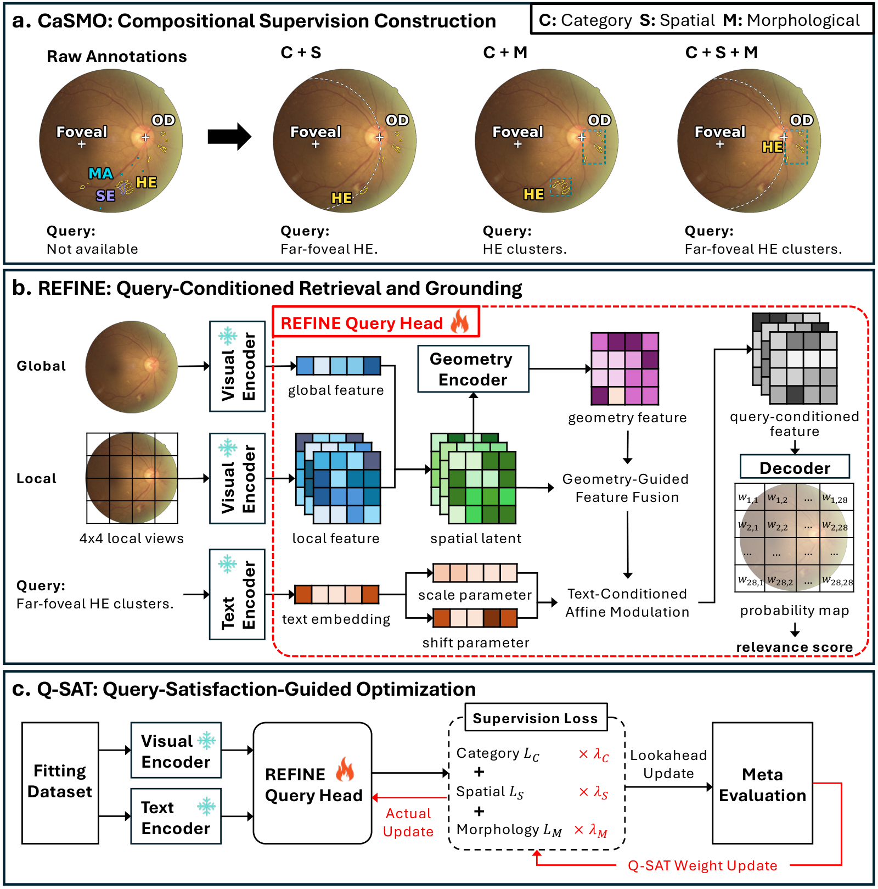

# REFINE

Code, trained query heads and CaSMO annotations for compositional retinal image retrieval and grounding.



[Figure Legend (PDF)](figures/Figure_Legend.pdf)

## Method

REFINE answers queries that combine a lesion category, an anatomical relation and the organization of lesion groups, such as **“far-foveal hemorrhage clusters.”** The figure shows its three components.

**CaSMO: compositional supervision.** Category (C) targets identify hard exudates, hemorrhages, microaneurysms and soft exudates. Spatial (S) targets select lesions using foveal distance and disc-relative direction. Morphology (M) targets select members of geometric clusters, arcs and radial-axis groups. Combining these conditions constructs a query-specific target on the same lesion evidence. Positive, known non-target and unknown regions are represented separately.

**REFINE: retrieval and grounding.** Frozen visual encoders provide global context and local features from a full-image view and sixteen tiles. A trainable head fuses these features with a ten-channel latent geometry encoding. The geometry predictor uses image features to estimate two reference points and two scales. Text-conditioned affine modulation and a shared decoder produce a query probability map. Image relevance is read from that map, coupling retrieval with localized evidence. Inference uses image features, image support and the query embedding.

**Q-SAT: query-satisfaction-guided optimization.** A separate META subset guides the C/S/M supervision weights and morphology-category weights. Feedback measures relevance, regional specificity, paired near/far discrimination and group-member coverage. A one-step lookahead guides the weight update; AdamW fits the query head on CORE examples.

## Installation

```bash
git clone https://github.com/leeyan0612/REFINE.git
cd REFINE
pip install -e .
```

Python 3.10+ and PyTorch 2.5+ are required. Use a CUDA build of PyTorch for GPU training.

Frozen encoders are obtained from their authors:

- [RET-CLIP](https://github.com/sStonemason/RET-CLIP): visual features.
- [EyeCLIP](https://github.com/Michi-3000/EyeCLIP): 512-dimensional sentence embeddings.

## Data and models

Annotation directories use the **official image filename without its extension**. The manifest records the complete filename, data role, reference sources and checksums.

```text
annotations/
  IDRiD/IDRiD_53/
  DDR/007-1774-100/
  manifest.json
weights/
  retclip_qsat_seed1901.safetensors
  retclip_qsat_seed1903.safetensors
  retclip_qsat_seed1907.safetensors
```

Each image directory contains `targets.npz`, `components.npz`, `members.npz` and `groups.json`. [Annotation formats and attribution](annotations/README.md) describe these fields. The dataset contains 81 IDRiD and 532 DDR source images; the CORE/META/CAL roles contain 360/91/162 images. `weights/manifest.json` lists the model dimensions and SHA-256 checksums.

Feature files follow the same official image names:

```text
features/
  IDRiD/IDRiD_53.npz
  DDR/007-1774-100.npz
```

For each image, store two independently encoded orientations in `local [2,784,768]` and `global_features [2,512]`. Use the author encoder preprocessing. Tile features are registered by physical area overlap onto the 28×28 grid; the full view supplies global context. The EyeCLIP text bank contains `train [64,3,512]` in C4/S32/S-child8/M20 order.

## Training

```bash
python -m refine.train \
  --annotations annotations/manifest.json \
  --feature-root features \
  --text-bank eyeclip_text.npz \
  --output outputs/refine \
  --seed 1901 --steps 3000 --device cuda
```

The annotation reader selects the permitted C4/S28/M16 objectives and uses the manifest roles. Default hyperparameters are listed in `configs/retclip_qsat.json`. Use `--static` for fixed supervision weights. [Tensor interfaces](docs/data_format.md) describe the prepared-batch API.

## Inference

```bash
python -m refine.infer \
  --weights weights/retclip_qsat_seed1901.safetensors \
  --features query_features.npz \
  --output outputs/query_maps.npz --device cuda
```

The input NPZ contains:

| Field | Shape | Description |
|---|---|---|
| `local` | `[B,784,768]` | Local visual features |
| `global_features` | `[B,512]` | Full-image context |
| `text_vectors` | `[Q,512]` | EyeCLIP query embeddings |
| `support` | `[B,256,256]` | Image-only non-padding support |

Outputs include sigmoid query maps, image relevance scores and latent geometry predictions.

```python
from refine import load_model
model = load_model("weights/retclip_qsat_seed1901.safetensors", device="cuda")
```

## Evaluation

```python
from refine.metrics import image_ap
ap = image_ap(scores, relevance)
```

Relevance labels are 1 for a match, 0 for a known non-match and −1 for unknown. AP groups exact score ties and excludes unknown references. `image_map` returns per-query AP and the strict query macro.

## Citation and license

```bibtex
@software{refine2026,
  author = {{REFINE contributors}},
  title = {REFINE: Compositional Retinal Retrieval with CaSMO and Q-SAT},
  year = {2026},
  url = {https://github.com/leeyan0612/REFINE}
}
```

Code is distributed under the [MIT License](LICENSE). Model weights and derived annotations use [CC BY-NC-SA 4.0](https://creativecommons.org/licenses/by-nc-sa/4.0/), with original data attribution retained. Please also cite [IDRiD](https://doi.org/10.3390/data3030025), [DDR](https://github.com/nkicsl/DDR-dataset), the author encoders and [Auto-Lambda](https://github.com/lorenmt/auto-lambda) as applicable.
